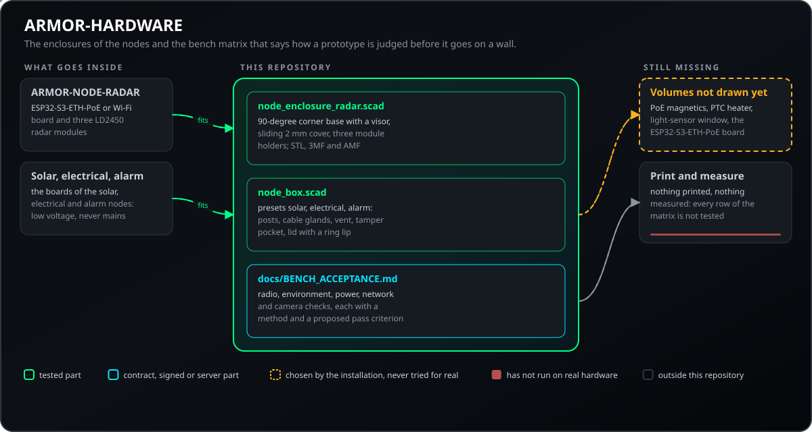
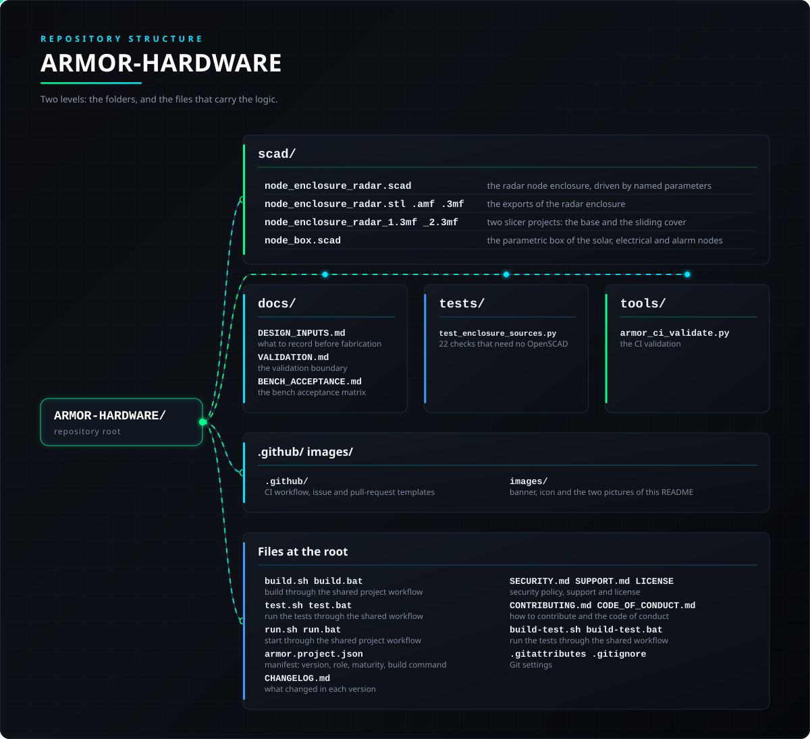

<p align="center">
  
</p>

# 🧱 ARMOR-HARDWARE

<p align="center">
  <a href="README.md">🇺🇸 English</a> |
  <a href="README_spa.md">🇪🇸 Español</a> |
  <a href="README_fra.md">🇫🇷 Français</a> |
  <a href="README_ita.md">🇮🇹 Italiano</a> |
  <a href="README_deu.md">🇩🇪 Deutsch</a> |
  <a href="README_zho.md">🇨🇳 简体中文</a> |
  🇯🇵 <b>日本語</b> |
  <a href="README_por.md">🇵🇹 Português</a>
</p>

### 筐体、電子部品、ベンチ受け入れマトリクス

<p align="center">
  
  
  
  
  
</p>

---

**正直さのチェック - 今日動いているもの:** レーダーの筐体は**印刷できる機構の出発点であり、IP・RF・熱の等級ではなく**、太陽光・電気・警報ノード用のパラメトリックボックスはソースの `assert` で検査されています（基板が収まる、ケーブル穴が収まる、蓋がポストを避ける）が、**どれも印刷も計測もされていません**（基板の寸法はデータシート由来で、タッチパネルには印刷ボックスはなく、出荷時の筐体を使います）。[ベンチ受入マトリクス](docs/BENCH_ACCEPTANCE.md)のすべての行は*未テスト*です。

---

## 📋 ひと目で

| | |
|---|---|
| バージョン | `0.2.7` |
| 成熟度 | 機能する |
| 役割 | 筐体、電子部品、ベンチ受け入れマトリクス（ファミリー：Hardware、親：ARMOR-NODE-RADAR） |
| 技術 | OpenSCAD 2021.01+（CAD）、Python 3.11+（検査） |
| テスト | 22 (`python -m unittest discover -s tests`) |
| 設計 | レーダー筐体と 3 つのノードプリセット（ソーラー、電気、アラーム）の箱 |
| 動作環境 | OpenSCAD のある任意のコンピューター |
| 実機での確認 | まだありません：何も印刷も計測もされていません。3 つのボックスはソースの `assert` で検査されているだけです |
| ライセンス | GPL-3.0-or-later |

**移動先：** [概要](#-概要) · [アーキテクチャ](#-アーキテクチャ) · [セキュリティ](#-セキュリティと安全) · [設定](#-設定) · [クイックスタート](#-クイックスタート) · [テスト](#-テスト) · [トラブルシューティング](#-トラブルシューティング) · [構成](#-リポジトリの構成) · [関連](#-関連プロジェクト)

## 🚦 プロジェクトの状況

各行はこのリポジトリの一部分で、信号は今日どこまで進んでいるかを示します。計画ではなく、リポジトリが示せるもの（テスト、ビルド、実行）に基づいて書かれています。

🟢 完了・検証済み · 🟡 動作する（既知の制限あり） · 🟠 一部のみ、または未検証 · 🔴 未実装または動作しない

| 領域 | 状態 | ここでの意味 |
|---|---|---|
| ソフトウェア | 🟡 | レーダーの筐体と、太陽光・電気・警報ノード用のパラメトリックなボックスは OpenSCAD のソースです。レーダーのボックスは印刷できる出発点で、IP・RF・熱の等級ではありません。 |
| テスト | 🟡 | 22 件のテストが通ります（`python -m unittest discover -s tests`）：ソース、箱のプリセット、モデルファイル、文書が引用する数値。箱はソースの `assert` でも検証されますが、印刷も測定もしていません。 |
| ハードウェア | 🔴 | 何も印刷も実測もしておらず、基板の寸法はデータシートに基づいています。ベンチ受け入れマトリクスの全行が未テストです。 |
| ドキュメント | 🟢 | 8 言語、設計の入力条件、ベンチ受け入れマトリクスが書かれていて最新です。 |

## 🎯 概要

* **レーダーの筐体は `scad/node_enclosure_radar.scad`**（STL・3MF・AMF の出力と、ベースとスライドカバーの 2 つのスライサープロジェクト付き）：バイザー、屋根、床、固定用の段差、2 mm のスライド式フロントカバー、側面フラップを備えた 90 度コーナーのベースで、すべて名前付きパラメーターで動きます。
* **太陽光・電気・警報ノード用のパラメトリックボックス**（`scad/node_box.scad`、プリセット `solar`、`electrical`、`alarm`）：壁、基板用のポスト、ケーブルグランド用の穴、通気口、蓋の下の改ざん検知マイクロスイッチ用ポケット、リング状のリップ付きの蓋。低電圧用のボックスであり、商用電源配線用の筐体ではありません。
* **ホルダー**：3 つのレーダーモジュール、ケーブルグランド、排水穴用。ベンチマトリクスが試験したい ESP32-S3-ETH-PoE 基板、PoE マグネティクス、PTC ヒーター、光センサー窓の空間はまだありません。24 GHz の開口の前には、測定せずに金属・導電性・カーボン入りの材料を置かないでください。
* **ベンチ受入マトリクス：**無線、環境、電源、ネットワーク、カメラの検査それぞれに方法と合格基準の案があり、記入するカメラ互換表もあります。
* 製作前に、基板の正確な外形、コネクター、ネジ位置、アンテナの禁止領域、熱経路、侵入保護の目標を記録します（[設計入力](docs/DESIGN_INPUTS.md)）。

## 🧩 A.R.M.O.R. での役割

ARMOR-HARDWARE はノードを収めるものです。レーダーノードの筐体、太陽光・電気・警報・タッチパネルノードのパラメトリックボックス、壁に付ける前に試作品をどう評価するかを示すベンチ受入マトリクスを含みます。その設計は、[ARMOR-NODE-RADAR](https://github.com/JuanenRac/ARMOR-NODE-RADAR)、[ARMOR-NODE-SOLAR](https://github.com/JuanenRac/ARMOR-NODE-SOLAR)、[ARMOR-NODE-ELECTRICAL](https://github.com/JuanenRac/ARMOR-NODE-ELECTRICAL)、[ARMOR-NODE-ALARM](https://github.com/JuanenRac/ARMOR-NODE-ALARM)、[ARMOR-NODE-HMI](https://github.com/JuanenRac/ARMOR-NODE-HMI) が動く基板の出発点です。

## 🏛️ アーキテクチャ

<p align="center">
  
</p>

## 🔒 セキュリティと安全

| 脅威 | 対策 |
|---|---|
| プラスチックの箱での商用電源配線 | `node_box.scad` は低電圧用の箱で、商用電源配線用の筐体ではありません |
| 24 GHz レーダーの遮蔽 | 測定せずに 24 GHz の開口部の前へ金属・導電性・カーボン入り材料を置かない。カバー厚 2 mm はベンチマトリクスの 1 行です |
| 存在しないプリセットや部品 | `assert` がレンダリングを止めます：`preset must be solar, electrical or alarm`、`part must be box, lid or both` |
| 合わない造形物 | ソースの `assert` がレンダリング時に検出します：基板とポストが収まる、ケーブル穴が壁やポストで切られず内側より高くない、蓋のリップは 1.2〜3 mm |

レーダー筐体は印刷できる機構上の出発点であり、**IP・RF・熱の等級ではありません**。印刷も測定もしていません。

## ⚙️ 設定

| 名前 | 値 | 設定内容 |
|---|---|---|
| `wall`, `lid_t` | 3 mm, 3 mm | `node_box.scad` の壁と蓋の厚さ |
| `post_d`, `post_h`, `post_cap` | 7, 6, 9 mm | 基板と蓋ネジ用のポスト |
| `screw_d` | 3.2 mm | ポストにねじ込む M3 タッピングネジ |
| `clear`, `lip_w` | 0.3 mm, 1.6 mm | 蓋と箱の隙間、リング状リップの幅（1.2〜3 mm） |
| `preset`, `part` | `alarm` | `solar`、`electrical`、`alarm`／`box`、`lid`、`both` |
| `vent` | `true` | 熱を逃がすための蓋のスリット |

| 部品 | 内寸 (mm) | 基板 (mm) |
|---|---|---|
| `solar` | 110 × 80 × 45 | 66 × 53 |
| `electrical` | 140 × 100 × 50 | 120 × 80 |
| `alarm` | 150 × 110 × 60 | 120 × 80 |

## 🚀 クイックスタート

**必要なもの:** OpenSCAD 2021.01+ (筐体のレンダリング用), 試作用の 3D プリンター（FDM）.

```powershell
openscad -o build/node_enclosure_radar.stl scad/node_enclosure_radar.scad
openscad -D 'part="both"' -D 'preset="alarm"' -o build/node_box_alarm.stl scad/node_box.scad   # presets: solar, electrical, alarm
```

[検証の境界](docs/VALIDATION.md)を参照してください。想定しているハードウェアライセンスは CERN-OHL-S-2.0 で、設計を公開する前に全文を追加してください。

## 🧪 テスト

```powershell
python -m unittest discover -s tests   # 22 tests, no OpenSCAD needed
python -I tools/armor_ci_validate.py
```

| テストファイル | テスト数 | 対象 |
|---|---|---|
| `test_enclosure_sources.py` | 22 | ソース、箱のプリセット、モデルファイル、文書が引用する数値 |

OpenSCAD が使える環境では各部品（レーダーのベースとカバー、3 つのプリセットの箱と蓋）をレンダリングします。印刷した試作品は[ベンチ受け入れマトリクス](docs/BENCH_ACCEPTANCE.md)で評価します。

## 🩺 トラブルシューティング

| 症状 | 原因 | 対処 |
|---|---|---|
| `preset must be solar, electrical or alarm` | `preset` が別の値 | `-D 'preset="alarm"'` |
| `the board and its posts do not fit inside the box` | パラメーターのせいでポストが内側に収まらない | `post_d` を戻すか大きいプリセットを選ぶ |
| 蓋が閉まらない | プリンターの精度が 0.3 mm の隙間より厳しい | `clear` を大きくして再印刷 |

## 📂 リポジトリの構成

<p align="center">
  
</p>

<details>
<summary>ツリーのテキスト版</summary>

```text
ARMOR-HARDWARE/
├── scad/                                筐体とそのモデルファイル
├── docs/                                このリポジトリのガイド
├── tests/                               テスト
├── tools/                               共通の CI チェックとプロジェクトツール
├── .github/                             CI ワークフローと Issue・Pull Request のテンプレート
├── images/                              バナー、アイコン、この README の 2 つの図
├── build.sh build.bat                   共通のプロジェクトワークフローでビルド
├── test.sh test.bat                     共通のワークフローでテストを実行
├── run.sh run.bat                       共通のプロジェクトワークフローで起動
├── armor.project.json                   マニフェスト：バージョン、役割、成熟度、ビルドコマンド
├── CHANGELOG.md                         各バージョンの変更点
├── SECURITY.md SUPPORT.md LICENSE       セキュリティポリシー、サポート、ライセンス
├── CONTRIBUTING.md CODE_OF_CONDUCT.md   貢献方法と行動規範
├── build-test.sh build-test.bat         共通のワークフローでテストを実行
└── .gitattributes .gitignore            Git の設定
```

</details>

## 🗺️ ロードマップと既知の制限

**現時点の既知の制限**

* 印刷も測定もしておらず、基板サイズはデータシート由来で、ベンチ受け入れマトリクスの全行が*未試験*です。
* ESP32-S3-ETH-PoE 基板、PoE マグネティクス、PTC ヒーター、光センサー窓の立体はまだなく、タッチパネルには印刷した箱がありません（工場出荷時の筐体のままです）。
* 設計に予定しているハードウェアライセンスは CERN-OHL-S-2.0 で、全文はまだリポジトリにありません。

**今後**

* 正確な基板外形、コネクター、ネジ位置、アンテナの空き領域、放熱経路、防水目標を記録する（[設計入力](docs/DESIGN_INPUTS.md)）。
* 試作品を印刷し、日付入りの測定値でベンチ受け入れマトリクスを埋める。

## 🌍 言語

README とテキストは、英語、スペイン語、フランス語、イタリア語、ドイツ語、中国語、日本語、ヨーロッパポルトガル語で提供されています。

## 🔗 関連プロジェクト

**A.R.M.O.R.**（Autonomous Radar & Multimodal Observation Range）は、独立したリポジトリで構成される境界セキュリティシステムです。各リポジトリは独自のバージョン、テスト、README を持ちます。ファミリーは次のとおりです：

* **[ARMOR-COMMON](https://github.com/JuanenRac/ARMOR-COMMON)** - メッセージのコントラクト、バリデーター、適合ベクトル、生成された型
* **[ARMOR-NODE-RADAR](https://github.com/JuanenRac/ARMOR-NODE-RADAR)** - 3 つのレーダーと独自の Web パネルを備えた ESP32-S3 向けフィールドノードのファームウェア
* **[ARMOR-NODE-SOLAR](https://github.com/JuanenRac/ARMOR-NODE-SOLAR)** - ソーラーインバーターとバッテリーのプロトコル、ゲートウェイノードのメッセージ
* **[ARMOR-NODE-ELECTRICAL](https://github.com/JuanenRac/ARMOR-NODE-ELECTRICAL)** - 電気ノード：メーター、系統の読み取り値のメッセージ、切り替えのルール
* **[ARMOR-NODE-ALARM](https://github.com/JuanenRac/ARMOR-NODE-ALARM)** - 警報ノードとパネル：ゾーン、警戒、遅延、サイレン、PIN。サーバーありでもなしでも動作
* **[ARMOR-NODE-HMI](https://github.com/JuanenRac/ARMOR-NODE-HMI)** - タッチパネル：壁面画面でのシステムの状態、警戒と確認応答、そして音声アシスタントの置き場
* **[ARMOR-NETWORK](https://github.com/JuanenRac/ARMOR-NETWORK)** - ローカルネットワーク：そのデバイス、インターネット、そして変化
* **[ARMOR-SERVER](https://github.com/JuanenRac/ARMOR-SERVER)** - 中央コーディネーター：テレメトリ、警報、デバイス、ソーラーの読み取り値、カメラ
* **[ARMOR-STUDIO](https://github.com/JuanenRac/ARMOR-STUDIO)** - Web コンソール：カメラ、レーダー、警報、太陽光エネルギー、2D/3D のサイトデザイナー
* **[ARMOR-ANDROID-CONTROL](https://github.com/JuanenRac/ARMOR-ANDROID-CONTROL)** - ライブの 2D/3D レーダーを備えた Android オペレータークライアント
* **[ARMOR-IOS-CONTROL](https://github.com/JuanenRac/ARMOR-IOS-CONTROL)** - iPhone オペレータークライアント
* **[ARMOR-SERVER-AI](https://github.com/JuanenRac/ARMOR-SERVER-AI)** - 判断を説明し、決して作動させない視覚推論ポリシー
* **[ARMOR-VISION](https://github.com/JuanenRac/ARMOR-VISION)** - Jetson Orin NX 向けのカメラゾーン、マスク、検出ルール
* **[ARMOR-VOICE-AI](https://github.com/JuanenRac/ARMOR-VOICE-AI)** - 偽造できない確認つきのオフライン音声インテント
* **ARMOR-HARDWARE**（このリポジトリ） - 筐体、電子回路、ベンチ受け入れマトリクス
* **[ARMOR-DEVOPS](https://github.com/JuanenRac/ARMOR-DEVOPS)** - デプロイ、CM5 テストベンチ、バックアップ、TLS
* **[ARMOR-SIMULATOR](https://github.com/JuanenRac/ARMOR-SIMULATOR)** - 再現可能な障害を持つオフラインのテレメトリシミュレーター
* **[ARMOR-UPDATER](https://github.com/JuanenRac/ARMOR-UPDATER)** - エコシステム自身のリポジトリを検出、インストール、更新
* **[ARMOR-DOCS](https://github.com/JuanenRac/ARMOR-DOCS)** - アーキテクチャ、セキュリティのベースライン、機能マトリクス

## 📚 ドキュメント

* [設計入力](docs/DESIGN_INPUTS.md)：製造前に記録すること
* [検証の境界](docs/VALIDATION.md)：検証済みの範囲と未検証の範囲
* [ベンチ受け入れマトリクス](docs/BENCH_ACCEPTANCE.md)：検査、方法、合格基準の案
* [機能マトリクス：何が証明され、何が証明されていないか](https://github.com/JuanenRac/ARMOR-DOCS/blob/main/docs/CAPABILITY_MATRIX.md)
* [プロジェクトカタログ：バージョンと、リポジトリ同士の依存関係](https://github.com/JuanenRac/ARMOR-DOCS/blob/main/docs/PROJECT_CATALOG.md)
* [このリポジトリの変更履歴](CHANGELOG.md)

## 🤝 コントリビュートとコミュニティ

* Pull Request の前に `python -m unittest discover -s tests` and `python -I tools/armor_ci_validate.py` を実行してください。通る必要があります。[CONTRIBUTING.md](CONTRIBUTING.md) と[行動規範](CODE_OF_CONDUCT.md)を参照してください。
* README は 8 言語で提供され、ARMOR-DOCS のソースから生成されます。文面の変更はそちらで行います。
* コンポーネント間のメッセージの変更は ARMOR-COMMON から始めます。
* ビルドしただけのものを、ボード上で動いているかのように書かないでください。
* 脆弱性は非公開で報告してください：[SECURITY.md](SECURITY.md)。質問、アイデア、報告：electrohobby3d@gmail.com（[SUPPORT.md](SUPPORT.md)）。

## 👤 作者

**JuanenRac (Electro Hobby 3D)** · electrohobby3d@gmail.com

## 📜 ライセンス

GPL-3.0-or-later - [LICENSE](LICENSE) を参照してください。
