<p align="center">
  
</p>

# 🧱 ARMOR-HARDWARE

<p align="center">
  <a href="README.md">🇺🇸 English</a> |
  <a href="README_spa.md">🇪🇸 Español</a> |
  <a href="README_fra.md">🇫🇷 Français</a> |
  <a href="README_ita.md">🇮🇹 Italiano</a> |
  <a href="README_deu.md">🇩🇪 Deutsch</a> |
  <a href="README_zho.md">🇨🇳 简体中文</a> |
  <a href="README_jpn.md">🇯🇵 日本語</a> |
  <a href="README_por.md">🇵🇹 Português</a>
</p>


### Caixas, eletrónica e a matriz de aceitação de bancada

<p align="center">
  
  
  
  
</p>

---

**Verificação de honestidade - o que funciona hoje:** A caixa é um **ponto de partida mecânico imprimível, não uma classificação IP, RF ou térmica.** Nada foi medido num protótipo; cada linha da [matriz de aceitação de bancada](docs/BENCH_ACCEPTANCE.md) está *sem testar*.

---

## 🎯 Visão geral

* **O desenho real é `CAD/CARCASA_SENSORES.scad`** (com exportações STL, 3MF e AMF): uma base de canto a 90 graus com viseira, telhado e piso, degraus de retenção, uma tampa frontal deslizante de 2 mm e abas laterais, tudo dirigido por parâmetros com nome. `scad/node_enclosure.scad` é apenas uma caixa provisória.
* **Volumes reservados** para três módulos de radar, a placa ESP32-S3-ETH-PoE, a janela do sensor, um bucim, a magnética PoE e o aquecedor PTC. Nenhum material metálico, condutor ou carregado de carbono à frente de uma abertura de 24 GHz sem atenuação medida.
* **Matriz de aceitação de bancada:** as verificações de rádio, ambiente, alimentação, rede e câmaras com um método e um critério de aprovação proposto cada uma, e uma tabela de compatibilidade de câmaras por preencher.
* Antes do fabrico, registe os contornos exatos das placas, conectores, posições de parafusos, zonas livres de antena, o caminho térmico e o objetivo de proteção contra a entrada ([entradas de desenho](docs/DESIGN_INPUTS.md)).

## 📂 Estrutura do repositório

```text
ARMOR-HARDWARE/
├── CAD/     CARCASA_SENSORES.scad (+ stl, 3mf, amf)
├── scad/    node_enclosure.scad (placeholder)
├── EDA/     KiCad (empty)
└── docs/    DESIGN_INPUTS, VALIDATION, BENCH_ACCEPTANCE
```

## 🛠️ Ambiente de desenvolvimento

```powershell
openscad -o build/CARCASA_SENSORES.stl CAD/CARCASA_SENSORES.scad
```

Veja a [fronteira de validação](docs/VALIDATION.md). A licença de hardware pretendida é a CERN-OHL-S-2.0; acrescente o seu texto completo antes de publicar os desenhos.

## 🔗 Projetos relacionados

O **A.R.M.O.R.** (Autonomous Radar & Multimodal Observation Range) é um sistema de segurança perimetral feito de repositórios independentes. Cada um tem a sua própria versão, os seus próprios testes e o seu próprio README; esta é a família:

* **[ARMOR-COMMON](https://github.com/JuanenRac/ARMOR-COMMON)** - Contratos de mensagens, validadores, vetores de conformidade e tipos gerados
* **[ARMOR-RADAR](https://github.com/JuanenRac/ARMOR-RADAR)** - Firmware de nó de campo para ESP32-S3 com três radares e o seu próprio painel web
* **[ARMOR-SOLAR](https://github.com/JuanenRac/ARMOR-SOLAR)** - Protocolos de inversores e baterias solares e as mensagens de um nó de ligação
* **[ARMOR-ELECTRICAL](https://github.com/JuanenRac/ARMOR-ELECTRICAL)** - Nó elétrico: contadores, a mensagem das leituras da rede e as regras de comutação
* **[ARMOR-HMI](https://github.com/JuanenRac/ARMOR-HMI)** - Painel tátil: o estado do sistema num ecrã de parede, armar e reconhecer, e a casa do assistente de voz
* **[ARMOR-NETWORK](https://github.com/JuanenRac/ARMOR-NETWORK)** - A rede local: os seus dispositivos, a internet e o que muda
* **[ARMOR-SERVER](https://github.com/JuanenRac/ARMOR-SERVER)** - Coordenador central: telemetria, alarmes, dispositivos, leituras solares e câmaras
* **[ARMOR-STUDIO](https://github.com/JuanenRac/ARMOR-STUDIO)** - Consola web: câmaras, radar, alarmes, energia solar e o desenhador de local 2D/3D
* **[ARMOR-ANDROID-CONTROL](https://github.com/JuanenRac/ARMOR-ANDROID-CONTROL)** - Cliente Android de operador com um radar 2D/3D em direto
* **[ARMOR-SERVER-AI](https://github.com/JuanenRac/ARMOR-SERVER-AI)** - Política de inferência visual que explica as suas decisões e nunca atua
* **[ARMOR-VOICE-AI](https://github.com/JuanenRac/ARMOR-VOICE-AI)** - Intenções de voz offline com uma confirmação que não se pode falsificar
* **ARMOR-HARDWARE** (este repositório) - Caixas, eletrónica e a matriz de aceitação de bancada
* **[ARMOR-DEVOPS](https://github.com/JuanenRac/ARMOR-DEVOPS)** - Implementação, a bancada de testes CM5, cópias de segurança e TLS
* **[ARMOR-SIMULATOR](https://github.com/JuanenRac/ARMOR-SIMULATOR)** - Simulador de telemetria offline com falhas repetíveis
* **[ARMOR-UPDATER](https://github.com/JuanenRac/ARMOR-UPDATER)** - Deteta, instala e atualiza os próprios repositórios do ecossistema
* **[ARMOR-DOCS](https://github.com/JuanenRac/ARMOR-DOCS)** - Arquitetura, linha de base de segurança e a matriz de capacidades

## 📚 Documentação e comunidade

Onde ler mais:

* [Matriz de capacidades: o que está provado e o que não](https://github.com/JuanenRac/ARMOR-DOCS/blob/main/docs/CAPABILITY_MATRIX.md)
* [Catálogo de projetos: versões e como os repositórios dependem uns dos outros](https://github.com/JuanenRac/ARMOR-DOCS/blob/main/docs/PROJECT_CATALOG.md)
* [Registo de alterações deste repositório](CHANGELOG.md)
* [Licença (GPL-3.0-or-later)](LICENSE)
* Perguntas, ideias e relatórios: electrohobby3d@gmail.com

## 👤 AUTOR

**JuanenRac (Electro Hobby 3D)** · electrohobby3d@gmail.com

## 📜 LICENÇA

GPL-3.0-or-later - veja [LICENSE](LICENSE).
